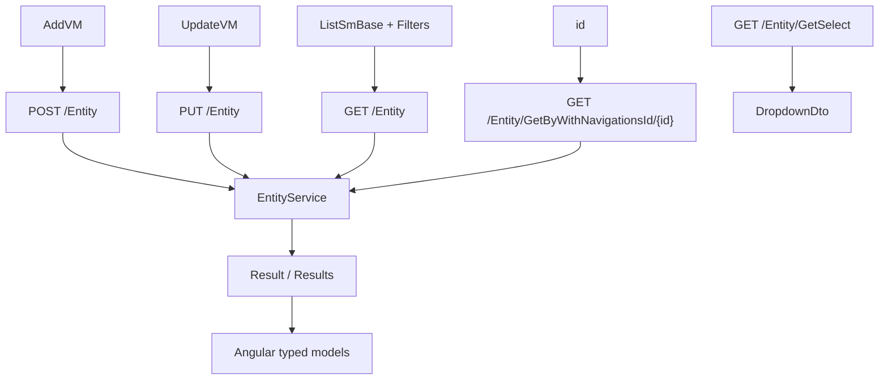

# Sigma Project Map

This document is a tool-neutral architecture map for the Sigma application.
It is suitable as context for code-navigation tools, including Gravity, and
for manual review of frontend/backend changes.

This map was created from the repository structure and source contracts. It
does not replace the source code, API documentation, or deployment
configuration.

Last checked against source: 2026-10-23 (frontend platform and shell layout,
Staff routes and salary/bank-account contracts, shared response models).
Rules for building screens live in `AGENTS.md`, the canonical books, and the
`sigma-screen-refactor` skill; this map describes structure only.

## 1. Repository layout

```text
F:\My Work\Sigma
├── SiGmaAngularFrontEnd/       Angular web application
├── SigmaBackend/               .NET backend solution
├── reviews/                    review and contract artifacts
└── PROJECT_MAP.md              This map
```

The workspace root is not a Git repository. Each application folder is its own
repository: `F:\My Work\Sigma\SiGmaAngularFrontEnd` and
`F:\My Work\Sigma\SigmaBackend`.

The frontend and backend are separate applications in the same workspace.
They communicate through HTTP APIs exposed by `SiGma.ServerAPI`.

## 2. System flow

```mermaid
flowchart LR
    Browser["Angular browser application"]
    Routes["Feature routes"]
    Components["List / details components"]
    FrontService["Typed Angular services"]
    API["SiGma.ServerAPI controllers"]
    Business["Business services"]
    Repo["Repository / UnitOfWork"]
    EF["EF Core DbContext"]
    DB[("SQL database")]

    Browser --> Routes
    Routes --> Components
    Components --> FrontService
    FrontService -->|HTTP JSON| API
    API --> Business
    Business --> Repo
    Repo --> EF
    EF --> DB
```



The normal request path is:

```text
Angular component
  -> feature service
  -> HTTP endpoint
  -> ServerAPI controller
  -> business service
  -> repository / UnitOfWork
  -> EF Core / database
  -> Result or Results<T>
  -> Angular response model
```

## 3. Angular frontend

### Application shell

The current frontend uses Angular 21 and PrimeNG 21. The application-owned
shell lives in `src/app/layout`; the retired `_metronic` tree and `ms-lib`
package are no longer navigation or implementation references. Independently
used Bootstrap Icons remain a dependency; Bootstrap component styles do not.

```text
SiGmaAngularFrontEnd/
├── src/
│   ├── main.ts                         bootstrap
│   ├── styles.scss                     global theme and shared styles
│   └── app/
│       ├── app.config.ts               standalone root providers
│       ├── app.component.*             standalone application root
│       ├── app.routes.ts               hash-based root routing
│       ├── modules/                    business features and shared owners
│       │   ├── shared/                 shared components/services/models/enums
│       │   ├── auth/                   authentication screens/state
│       │   └── i18n/                   translations
│       ├── pages/                      shared/page-level screens
│       └── layout/                     native Sigma shell, navigation and theme
├── angular.json
├── package.json
└── tsconfig*.json
```

### Main business module groups

| Group | Main responsibility |
|---|---|
| `Accounts` | Accounts, journals, ledgers, fiscal years, financial statements |
| `Administration` | Branches, countries, roles, settings, imports, audit/configuration |
| `Banking` | Banks, cheques/PDCs, deposits, reconciliation, transfers |
| `Billing` | Bills, invoices, billing settings |
| `Customers` | Individual/company partners, contacts, balances, statements |
| `Equipment Rental` | Equipment, quotations, agreements, delivery, invoices |
| `Fleet` | Vehicles, service logs, fines, tolls, alerts, maintenance |
| `HRM` | HR administration, staff roles, timesheets, attendance |
| `Lease` | Lease agreements and related screens |
| `Limousine` | Limousine agreements, bookings, invoices, operations |
| `Movements` | Operational stock/asset movements |
| `Reports` / `stockReports` | Reporting screens and report-specific filters |
| `Sales` | Sales agreements, quotations, invoices, customers |
| `Staff` | Staff, designations, timesheets, overtime, balances, alerts |
| `Stock` | Items, inventory, requisitions, receipts, issues, transfers |
| `Suppliers` | Suppliers, statements, balances, invoices |
| `Transportation` | Transportation agreements, trips, bookings, invoices |
| `Vouchers` | Journal/payment/receipt and related voucher screens |
| `Workshop` | Workshop operations and service workflows |
| `shared` | Reusable UI, HTTP/base services, DTOs, pipes, helpers |

### Feature convention

Most CRUD features follow this shape:

```text
modules/<Domain>/<Feature>/
├── <feature>.routes.ts
├── components/
│   ├── list/
│   │   ├── list.component.ts
│   │   ├── list.component.html
│   │   ├── list.component.scss
│   │   └── list.component.spec.ts
│   └── details/
│       ├── details.component.ts
│       ├── details.component.html
│       ├── details.component.scss
│       └── details.component.spec.ts
├── models/
│   ├── list.ts
│   ├── details.ts
│   └── create.ts
└── services/
    └── <feature>.service.ts
```

Responsibilities:

| Layer | Owns |
|---|---|
| Route | URL, create/view/edit mode, lazy-loading boundary |
| List component | Filters, table rows, actions, paging, export, refresh |
| Details component | Reactive form, steps, validation, save, nested rows |
| Feature service | API URLs, HTTP parameters, typed request/response models |
| Models | API contracts; separate list/detail/create/update shapes |
| Shared services | HTTP base behavior, translations, uploads, dialogs, lookups |

## 4. Staff feature map

### Frontend

```text
SiGmaAngularFrontEnd/src/app/modules/Staff/Staff/
├── staff.routes.ts
├── components/
│   ├── list/
│   │   ├── list.component.ts           grid state and server paging
│   │   ├── list.component.html         heading, filters, table, actions
│   │   └── list.component.scss
│   └── details/
│       ├── details.component.ts        create/view/edit step form
│       ├── details.component.html      Details/Documents/Salary/Eligibility
│       └── details.component.scss
├── models/
│   ├── list.ts
│   ├── details.ts
│   ├── create.ts
│   ├── branch.ts
│   ├── enums.ts
│   └── form.ts
└── services/
    └── staff.service.ts
```

Staff routes:

```text
/Staff                         list
/Staff/create                  create
/Staff/view/:id                view/read-only
/Staff/edit/:id                edit
```

The Staff editor sends bank-account collections in its Add/Update payloads.
Create may include an initial `salaryPackage`; the existing-record editor
loads the salary package read-only. Salary revisions use the dedicated
`GET`/`PUT /Staff/{staffId}/SalaryPackage` contract rather than Staff Update.
The route guards delegate dirty-exit handling to the list/editor components.

### Backend

```text
SigmaBackend/
├── SiGma.ServerAPI/
│   └── Controller/StaffController.cs
├── SiGma.Business/
│   ├── IServices/IStaffService.cs
│   ├── Services/StaffServices/StaffService.cs
│   └── MapperConfig/StaffProfiler.cs
├── SiGma.ViewModels/
│   └── ViewModels/Staff/
│       ├── StaffAddVm.cs
│       ├── StaffUpdateVm.cs
│       ├── StaffDetailVm.cs
│       └── StaffListVm.cs
├── SiGma.Helpers/
│   └── Models/Staffs/Staff.cs
├── SiGma.DataAccess/
│   ├── Configuration/StaffConfig.cs
│   └── SiGmaDbContext.cs
└── SiGma.Repos/
    └── Repository/Repository.cs
```

Staff API (generic endpoints inherited from `SiGmaControllerBase`, reports and
salary operations declared on `StaffController`):

| Verb | Endpoint | Purpose |
|---|---|---|
| `GET` | `/Staff` | Searchable paged list |
| `GET` | `/Staff/GetByWithNavigationsId/{id}` | Detail with navigations |
| `GET` | `/Staff/GetSelect` | Dropdown options |
| `POST` | `/Staff` | Create |
| `PUT` | `/Staff` | Update |
| `DELETE` | `/Staff?id={id}` | Soft-delete/delete policy |
| `GET` | `/Staff/Alerts` | Document alerts |
| `GET` | `/Staff/Statement` | Staff statement report |
| `GET` | `/Staff/BalancesSummary` | Staff balances report |
| `GET` | `/Staff/DutySchedule` | Duty schedule |
| `POST` | `/Staff/DutySchedule` | Save duty schedule |
| `GET` | `/Staff/Overtime` | Overtime data |
| `POST` | `/Staff/Overtime` | Save overtime |
| `GET` | `/Staff/{staffId}/SalaryPackage` | Current salary revision |
| `PUT` | `/Staff/{staffId}/SalaryPackage` | Revise salary package |

## 5. .NET backend layers

```text
SigmaBackend/
├── SiGma.ServerAPI/             HTTP API host and controllers
├── SiGma.Business/              services, interfaces, mappers, specifications
├── SiGma.ViewModels/            API request/response contracts
├── SiGma.Helpers/               entities, enums, DTOs, shared result/request types
├── SiGma.DataAccess/            DbContext, EF configuration, migrations
├── SiGma.Repos/                 repository and UnitOfWork access
├── SiGma.Security/              authentication and security controllers
├── SiGma.SubscriptionAPI/       subscription-related API
└── SiGma.CustomerMVC/           MVC/web host and subscription-facing screens
```

### Layer rules

| Change | Primary location |
|---|---|
| Route or HTTP verb | `SiGma.ServerAPI/Controller` |
| Request/response field | `SiGma.ViewModels` |
| Business rule or FK validation | `SiGma.Business/Services` |
| API method contract | `SiGma.Business/IServices` |
| Mapping | `SiGma.Business/MapperConfig` |
| Entity property/relationship | `SiGma.Helpers/Models` |
| Table/index/relationship configuration | `SiGma.DataAccess/Configuration` |
| Query/tenant/soft-delete helper | `SiGma.Repos` |
| Database schema history | `SiGma.DataAccess/Migrations` |
| Authentication | `SiGma.Security` and API configuration; Angular `AuthGuard` protects authenticated routes. No application permission mechanism is defined |

Do not put business rules in Angular, controllers, AutoMapper profiles, or
EF configuration. Do not put UI-specific display labels in backend entities.

## 6. API contract map



Illustrative response fields (not exhaustive):

```json
{
  "isSuccess": true,
  "message": "",
  "entity": {},
  "id": 123
}
```

```json
{
  "isSuccess": true,
  "entities": [],
  "pageNo": 1,
  "pageSize": 10,
  "totalCount": 0,
  "totalPages": 0
}
```

The shared frontend models are `Result<T>` and `Results<T>` under
`src/app/modules/shared/models/`. A single-record response has nullable
`entity`; a list response has `entities` and no `entity`. The shared ID can be
a number, string or null; total pages are nullable and total count is optional
or nullable in the frontend model. The page size above is illustrative.
The backend result types also expose error/status metadata. Exact fields and
casing are governed by the actual endpoint and API JSON configuration.

## 7. Where to make a change

For a normal CRUD request:

1. Read the frontend route, component, model, and service.
2. Read the backend controller and inherited base endpoint.
3. Read the Add/Update/Detail/List ViewModels.
4. Read the entity and EF configuration.
5. Read the service and mapper.
6. Confirm repository tenant/soft-delete behavior.
7. Change the smallest complete contract slice.
8. Update translations and documentation when the UI contract changes.
9. Hand the work to the owner for build, tests, and API verification.

Examples:

| Request | Files normally involved |
|---|---|
| Add a required field | AddVM, UpdateVM, entity, mapper, Angular create/details model/form, translation |
| Add a list filter | List query model, Angular service/list, backend service, response count/paging |
| Add a child table | Add/Update/Detail child VMs, entity relationship, mapper, service validation, form row handling |
| Add a lookup dropdown | Backend `GetSelect`/lookup controller, Angular lookup service, details form |
| Change delete behavior | Backend service `RemoveAsync`, reference checks, UI action/message |
| Add an index | Query evidence, entity configuration, migration, deployment plan |

## 8. Review checklist for this project

- [ ] The frontend route maps to the intended backend controller.
- [ ] Add, Update, Detail, and List fields have one documented contract.
- [ ] Required fields are validated server-side.
- [ ] Optional fields remain optional through DTO, entity, mapper, and UI.
- [ ] Numeric enums and dates use one agreed serialization convention.
- [ ] Foreign keys are checked against the current subscription.
- [ ] Soft-deleted records cannot be selected or attached accidentally.
- [ ] Duplicate rules are scoped and exclude the current record on Update.
- [ ] Nested child update behavior is explicit.
- [ ] Delete rules protect referenced records.
- [ ] List queries filter before count and paging.
- [ ] List responses provide both total count and total pages.
- [ ] Grid queries do not load unnecessary deep navigation graphs.
- [ ] Detail queries load the fields required by the detail screen.
- [ ] Search and date filters remain database-translatable.
- [ ] Error messages use the existing `Result` convention.
- [ ] No new architecture was introduced for a single feature.

## 9. Tool handoff

For Gravity or another code-navigation tool, provide this file together with
the specific feature folder and ask it to:

```text
Use PROJECT_MAP.md as the repository architecture map.
Trace the requested feature from Angular route to API controller,
business service, ViewModels, mapper, repository, entity, and EF configuration.
Review the contract and business rules before editing.
Preserve the existing Sigma patterns.
Report the smallest safe change and list files that must be updated.
Do not build or test unless explicitly requested.
```

