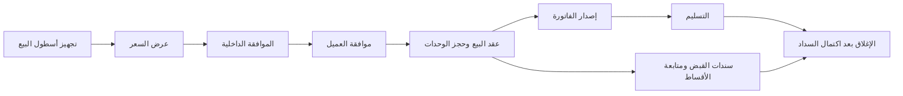

# شرح دورة المبيعات في Sigma

| البيان | الحالة |
|---|---|
| Status | Implemented — source-only |
| Owner verification pending | yes |

هذا الدليل يشرح الشاشات والإجراءات الموجودة في وحدة Sales، ويمكن استخدامه أثناء عرض النظام للعميل.

## الفكرة الأساسية

«نبدأ بتجهيز الوحدات المتاحة للبيع، ثم نقدم عرض سعر للعميل. بعد الموافقات نحول العرض إلى عقد ونحدد الوحدات وجدول السداد. نسجل التحصيل بسندات قبض، ونصدر الفاتورة، ثم نسلم الوحدات ونغلق العقد بعد اكتمال التسليم والسداد».

التحصيل قد يبدأ قبل إصدار الفاتورة ويستمر بعدها؛ الرسم يوضح مراحل البيع ومسار التحصيل الموازي لها. ويمكن إنشاء عقد مباشر عندما لا يحتاج العمل إلى عرض سعر سابق.

## 1. تجهيز أسطول البيع — Sales Fleet

نسجل بيانات الوحدة: الفرع، الماركة والموديل، سنة الصنع، اللوحة ورقم الشاسيه، تاريخ الشراء وتكلفة الشراء، والمستندات والضمانات عند الحاجة.

قبل اختيار وحدة للبيع، يلزم أن تكون نشطة ومتاحة للبيع، ولها موديل ورقم شاسيه، وألا تكون مؤجرة بتسليم مفتوح. ويلزم تسجيل تكلفة شراء موجبة قبل إصدار فاتورة البيع.

**عبارة للعميل:** «الشاشة دي بتحدد مخزون الوحدات اللي نقدر نبيعها، وبتمنع اختيار وحدة اتباعت أو اتحجزت في عقد آخر أو ما زالت خارجة في إيجار».

## 2. إعداد عرض السعر — Sales Quotation

نختار العميل وتاريخ العرض وصلاحيته، ثم نضيف الموديلات والكميات وسعر الوحدة والملاحظات. نحدد الدفعة المقدمة وعدد الأقساط وشروط العرض. النظام يحسب إجمالي العرض والضريبة والمتبقي والقسط المتوقع.

عرض السعر يحدد الموديل والكمية؛ اختيار الوحدات الفعلية وأرقام الشاسيه يتم في عقد البيع. مدة الصلاحية تمنع الموافقة النهائية أو إنشاء عقد جديد من عرض منتهي.

**عبارة للعميل:** «عرض السعر هو الاتفاق المبدئي على الموديلات والأسعار وخطة السداد، ولسه مش حجز للوحدات الفعلية».

## 3. الموافقات على العرض

| المرحلة | ما الذي يحدث؟ |
|---|---|
| Pending | إعداد العرض ومراجعته قبل الموافقة |
| Internally Approved | الموافقة الداخلية على العرض |
| Customer Approved | تسجيل موافقة العميل على العرض |
| Converted | إنشاء عقد بيع مرتبط بالعرض |

الرفض الداخلي أو رفض العميل يسجل سبب الرفض. إجراء **Revise** يعيد العرض الموافق عليه داخليًا إلى **Pending**، وتعديل العرض المرفوض داخليًا يعيده أيضًا إلى **Pending**. إجراء **UnApprove** يعيد **Customer Approved** إلى **Internally Approved** بشرط عدم وجود عقد قائم أو سند مقدم فعال. العرض المرفوض من العميل لا يتيح حاليًا إجراء مراجعة أو تعديل أو حذف من هذه القائمة. الموافقة الداخلية وموافقة العميل خطوتان منفصلتان.

بعد موافقة العميل، يمكن فتح إجراء سند الدفعة المقدمة إذا كانت هناك دفعة مقدمة ولم يوجد سند فعال لها. الإجراء يجهز سند القبض؛ يجب إكمال بيانات الفرع وطريقة الدفع وحفظ السند لتسجيل التحصيل.

**عبارة للعميل:** «الموافقة تؤكد قبول العرض؛ تسجيل مبلغ المقدم في العرض وحده ما يعنيش إنه اتحصل. التحصيل بيتسجل بسند قبض».

## 4. إنشاء عقد البيع — Sales Agreement

من العرض المقبول نختار **Open Agreement**. إذا كان له عقد قائم، يفتح النظام العقد؛ وإلا يفتح إنشاء عقد جديد ببيانات العرض. ونستطيع أيضًا إنشاء عقد مباشر.

نحدد تاريخ العقد والوحدات الفعلية وجدول السداد. عند الربط بعرض، يجب أن تطابق الوحدات موديلات العرض وكمياته، وتأتي الأسعار والشروط المالية من العرض. ويمكن تسجيل المستندات، وتواريخ الأقساط، وبيانات الشيكات والبنوك.

عند حفظ العقد تصبح حالته **Open** والوحدات **Reserved**، ويصبح العرض المرتبط **Converted**. الحجز يمنع بيع الوحدة مرة أخرى في عقد آخر.

**عبارة للعميل:** «هنا بنحول الموافقة إلى عقد، ونربط كل سيارة برقم شاسيه محدد ونحجزها للعميل».

## 5. خطة السداد والتحصيل الفعلي

الخطة تتكون من دفعة مقدمة وأقساط شهرية. النظام ينشئ مبالغ الجدول، ويحمل القسط الأخير فرق التقريب. تواريخ الأقساط وبيانات الشيكات تساعد في المتابعة؛ بيانات الشيك وحدها لا تسجل تحصيلًا.

نستخدم إجراء **Receipt** في العقد لتسجيل كل مبلغ مدفوع. النظام يربط السند بالعميل والعقد ويتحقق أن المبلغ لا يتجاوز الرصيد المتبقي. سند المقدم المرتبط بعرض السعر يدخل في حساب المدفوع للعقد المرتبط، فلا نسجله مرة ثانية.

يوزع النظام المدفوع على المقدم أولًا، ثم الأقساط بترتيب استحقاقها. وتظهر حالة كل بند: غير مدفوع، مدفوع جزئيًا، أو مدفوع بالكامل.

**عبارة للعميل:** «عندنا فرق واضح بين مبلغ مطلوب في الجدول ومبلغ اتحصل فعلًا. سند القبض هو اللي يحرك المدفوع والمتبقي».

## 6. إصدار فاتورة البيع — Invoice

من عقد **Open** نختار **Invoice** وندخل تاريخ الفاتورة. النظام يتحقق من صلاحية العقد والوحدات وتكاليف الشراء والإعدادات المحاسبية والفترة المحاسبية.

عند نجاح الإجراء ينشئ فاتورة البيع وقيدها، وتصبح حالة العقد **Invoiced** والوحدات **Sold**. وتصبح الوحدات غير نشطة حتى لا تستمر في قوائم الوحدات المتاحة للإيجار أو البيع.

الفاتورة تثبت البيع والمديونية؛ ليست إثباتًا أن العميل دفع كامل المبلغ. ولا تعدل الفاتورة الناتجة بصورة مستقلة عن مسار العقد.

**عبارة للعميل:** «الفاتورة تثبت عملية البيع محاسبيًا، وسندات القبض تثبت الفلوس اللي اتحصلت».

## 7. التسليم — Deliver

بعد إصدار الفاتورة نختار **Deliver** ونحدد تاريخ التسليم واسم المستلم والملاحظات عند الحاجة. النظام ينشئ مستند تسليم بيع لكل وحدة مرتبطة بالعقد.

تصبح حالة العقد والوحدات **Delivered**. مستند تسليم البيع مستقل عن مستند تسليم الإيجار. التسليم مرحلة تشغيلية؛ لا يشترط النظام اكتمال السداد لمجرد الانتقال إليها.

**عبارة للعميل:** «التسليم بيثبت إن الوحدات خرجت للعميل، مع مستند لكل وحدة. ولو البيع بالأقساط، التحصيل يفضل مستمر بعد التسليم».

## 8. متابعة الأقساط — Due Installments

نحدد فترة الاستحقاق، ويمكن تصفية التقرير بالعميل أو رقم العقد. افتراضيًا تظهر البنود التي لم تسدد بالكامل، ويمكن تضمين البنود المدفوعة.

يعرض التقرير مبلغ كل بند والمدفوع والمتبقي وحالة السداد وأيام التأخير وبيانات الشيك والبنك. إجماليات التقرير تشمل كل النتائج المطابقة للفلاتر، وتصدير Excel والطباعة يشملان النتائج كاملة، وليس الصفحة الحالية فقط.

**عبارة للعميل:** «من التقرير ده نعرف المطلوب تحصيله في الفترة، مين متأخر، والمتبقي على كل بند».

## 9. إغلاق العقد — Close

يظهر الإغلاق بعد التسليم وعندما يكون المتبقي **صفرًا**. عند تنفيذ الإجراء تصبح الحالة **Closed**.

إذا ألغي أو نقص سند قبض بعد الإغلاق وظهر رصيد مستحق، يعيد النظام العقد إلى **Delivered** حتى يمكن متابعة التحصيل. ظهور عقد مغلق لا يحول السندات الملغاة إلى مبالغ مدفوعة.

**عبارة للعميل:** «العقد يقفل لما التسليم يتم والمديونية تنتهي. ولو حصلت مشكلة في تحصيل سابق، الرصيد وحالة العقد يتحدثوا معًا».

## مثال بسيط أثناء العرض

مثال توضيحي يفترض نسبة ضريبة في الإعدادات **5%**، وبيعًا بقيمة **100,000** دون خصم:

| البيان | القيمة |
|---|---:|
| قيمة البيع | 100,000 |
| الضريبة | 5,000 |
| إجمالي العقد | 105,000 |
| الدفعة المقدمة المطلوبة | 20,000 |
| المتبقي في خطة السداد | 85,000 |
| عدد الأقساط | 10 |
| قيمة كل قسط في هذا المثال | 8,500 |

قبل حفظ أي سند قبض، المبلغ المحصل فعليًا يظل صفرًا. بعد سند مقدم بقيمة 20,000 يصبح الرصيد المستحق 85,000. بعد كل سند قسط ينخفض الرصيد بمبلغ السند، وبعد التسليم وسداد جميع المبالغ يمكن إغلاق العقد. النسبة الفعلية تأتي من إعدادات النظام؛ 5% هنا مجرد مثال.

## أسئلة شائعة أثناء الشرح

**هل يمكن البيع بدون عرض سعر؟** نعم، بإنشاء عقد مباشر واختيار الوحدات والأسعار وخطة السداد.

**هل المقدم المكتوب مدفوع؟** هو مبلغ متفق عليه ضمن خطة السداد؛ يصبح محصلًا عند حفظ سند القبض المرتبط.

**هل الأقساط تتضمن فوائد تمويل؟** الدورة الحالية تقسم المتبقي؛ لا يوجد حساب فوائد تمويل ضمن هذه الخطة.

**هل بيانات الشيك تعني أن قيمته تحصّلت؟** لا؛ التحصيل يتبع سندات القبض الفعالة.

**هل يمكن تعديل العقد بعد التحصيل؟** وجود سند فعال يقيد تعديل الشروط المالية. تبقى التعديلات التشغيلية المسموح بها، مثل مستندات العقد وبيانات الشيكات، بحسب حالة العقد وملكية بيانات العرض.

**متى يمكن الإلغاء؟** قبل إصدار الفاتورة وبالشروط التي يتحقق منها النظام، مع تسجيل السبب. وجود سند قبض مباشر على العقد يمنع الإلغاء حتى تتم معالجة السند. الإلغاء يحرر الوحدات ويعيد العرض المرتبط للمرحلة المسموح بها. بعد إصدار الفاتورة لا يستخدم هذا الإجراء لتصحيح البيع؛ تراجع معالجة الإشعار الدائن عبر الدورة المحاسبية الحالية.

## ترتيب عرض عملي للعميل

1. افتح وحدة متاحة في Sales Fleet ووضح رقم الشاسيه وتكلفة الشراء والحالة.
2. أنشئ عرضًا بموديل واحد، ووضح الكمية والسعر والمقدم وخطة الأقساط.
3. نفذ الموافقة الداخلية ثم موافقة العميل.
4. افتح العقد من العرض واختر الوحدة الفعلية واحفظه؛ أظهر حالة Reserved.
5. سجل سند المقدم من إجراء **Receipt** في العقد وأظهر الفرق بين المطلوب والمحصل والمتبقي. بعد تحويل العرض إلى عقد تختفي منه قائمة إنشاء سند المقدم؛ التحصيل يستكمل من العقد.
6. أصدر الفاتورة وأظهر حالتي Invoiced وSold.
7. نفذ التسليم وأظهر مستندات التسليم وحالة Delivered.
8. افتح Due Installments ووضح القسط والمدفوع والتأخير، ثم سجل تحصيلًا إضافيًا.
9. اعرض مثالًا مكتمل السداد لتوضيح شرط Close وحالة Closed.

التسلسل يوثق الوظائف الموجودة في المصدر. قبل جلسة العميل، جهز بيئة العرض واختبر السيناريو كاملًا على بيانات تجريبية، مع إعدادات الحسابات والضريبة والفترة المحاسبية المطلوبة.
