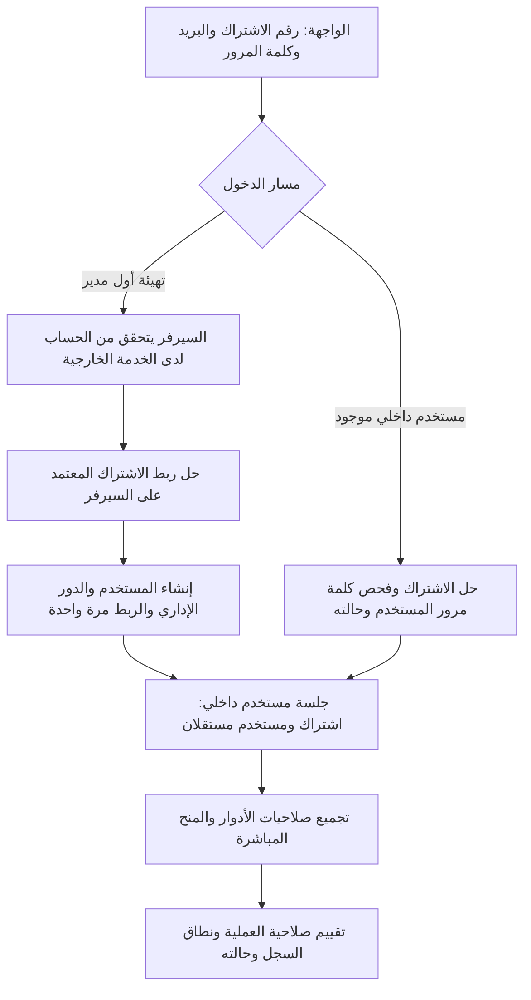

| Field | Value |
|---|---|
| Status | Blocked |
| Owner verification pending | yes |
| Date | 2026-10-16 |
| Deliverable | Design only — PLAN-00; no application implementation |
| Implementation gate | External subscriber verification/binding and lifecycle contract; proposed security/session rules below require freeze |
| Supersedes | Earlier unapproved roles/direct-Deny proposals in the historical authorization plan; only the dated owner decisions below are confirmed |

# تصميم دخول مستخدمي الاشتراك والأدوار والصلاحيات

## ١. المطلوب والقرارات المؤكدة

هذه وثيقة تصميم قابلة للمراجعة، وليست إعلانًا عن تنفيذ حماية في التطبيق. الحالة الحالية لا تزال تحقق تسجيل الدخول فقط. حالة الوثيقة تخص جاهزية تسليم التنفيذ؛ تصميم الأجزاء المستقلة موضح أدناه، وتكامل خدمة المشترك لم يُحسم بعد.

| القرار | الحالة والدليل |
|---|---|
| الإبقاء على خدمة تسجيل دخول المشترك الخارجية | Confirmed — توضيح المالك في المحادثة |
| المستخدمون الداخليون تابعون للاشتراك من خلال الحقل الموجود | Confirmed — المالك وافق على إعادة استخدام `User.SubscriptionId` |
| المستخدم يمكن أن يجمع عدة أدوار وعدة صلاحيات مباشرة | Confirmed — المالك: «اكثر من role مع اكثر من permission» |
| إدارة الأدوار وإسناد الصلاحيات لمدير الاشتراك فقط في البداية | Confirmed — إجابة المالك 2026-10-16 |
| بعد التحقق، إنشاء أول حساب مدير داخلي ببيانات دخول حساب المشترك | Confirmed — إجابة المالك؛ لا تعني حفظ كلمة المرور نصًا أو مزامنتها تلقائيًا لاحقًا |
| استقبال بيانات الدخول من الواجهة | Confirmed — المالك: «ممكن تستقبل البيانات من الفرونت»؛ السيرفر يتحقق منها ولا يعتمد قرار الواجهة |
| عرض الدور كقسم قابل للفتح، وداخله الكيانات وصلاحيات كل كيان | Confirmed — آخر توجيه للمالك؛ قواعد التفاعل في القسم ٨ |
| كل عملية إضافية لها تصنيف صلاحية صريح | Confirmed — النقاش السابق؛ العملية المختلفة لها مفتاح مستقل، والمساران لنفس العملية يمكن أن يشتركا في المفتاح |
| صيغة الإسناد في هذا المقترح | منح صلاحيات فقط، واتحاد الأدوار والمنح المباشرة. لم يطلب المالك منعًا مباشرًا؛ لا يُضاف `Deny` أو أولوية منع ضمنيًا |

الموافقة على عدة أدوار لا تعد موافقة على اقتراح المنع المباشر القديم. نطاقات الفروع، وإسناد أول مدير، وحالة الاشتراك، وحدود إدارة الصلاحيات ليست قابلة للاستنتاج من أسماء الأدوار أو عناصر القائمة.

## ٢. حدود العمل والأدلة

المراجع الحاكمة: ملف تعليمات Sigma، ودليل المراجعة الرئيسي خصوصًا الكتلتين ٤ و٥، وكتاب الواجهة خصوصًا ١ و١٣ و٢٦، وكتاب الخلفية خصوصًا ٣ و٥ و٨، ومهارة مراجعة شاشات Sigma. فحص مولد الحزم نجح للحزم الثماني بتاريخ الوثيقة. المستخدم طلب التصميم؛ الحزمة المطبقة هنا هي `PLAN-00` فقط، وبقية المراحل خطة لاحقة وليست مراحل تنفيذ مكتملة.

| الدليل | المصدر الفعلي والنتيجة |
|---|---|
| E1 | `SiGmaAngularFrontEnd/src/app/modules/auth/services/auth.service.ts` يستدعي `auth/consolelogin` في الخدمة الخارجية برقم الاشتراك والبريد وكلمة المرور؛ يخزن جلسة المشترك في المتصفح |
| E2 | `.../auth/models/login.ts` يصف استجابة تحتوي `id`, `subscriptionId`, `token`, `refreshToken`, `expiration`؛ المعرّفات نصية في نموذج الواجهة. هذا عقد استهلاك حالي، وليس توثيقًا كافيًا لثقة السيرفر أو معنى كل معرّف |
| E3 | `SigmaBackend/SiGma.Helpers/Models/User.cs` مستخدم محلي يرث الاشتراك؛ يحتوي `Roles` وحقلي كلمة مرور وتأكيدها. ليس هناك دليل تشغيل على محتوى البيانات المخزنة |
| E4 | `SiGma.ViewModels/ViewModels/User/UserDetailVm.cs` يعرض حقلي كلمة المرور؛ و`UserProfiler` يستخدم خرائط عكسية. يجب منع رجوع الأسرار في العقد المستهدف، مع مراجعة جميع مسارات القراءة العميقة |
| E5 | `SiGma.Helpers/Models/RolePermission.cs` يحتوي وصف وحدة وعملية وعنوان، دون طرفَي ربط الدور والصلاحية؛ لا يصلح حاليًا باعتباره جدول الإسناد المطلوب |
| E6 | `UserRole.cs` وتعريفات خدمته معلقة؛ `User.Roles` موجود، وتهيئة المستخدم لا تصف ربطًا صريحًا. وجود مجموعة أحادية الاتجاه لا يثبت علاقة متعدد إلى متعدد أو جدول وصل قائمًا؛ يلزم إثبات الشكل الفعلي وجرد يقدمه المالك قبل نقل البيانات |
| E7 | المساران الفعليان في الواجهة هما `Administration/Roles` و`Administration/Users`. شاشة الدور تنشئ بيانات للحفظ ثم تطبعها دون إرسالها؛ شاشة المستخدم ترسل `roleIds` بينما عقد الإضافة الخلفي يحتوي `Roles`. صفحة `pages/role` ليست مرجع المسار الفعلي |
| E8 | `SiGmaControllerBase` يوفر عمليات CRUD والقراءات العميقة والاختيارات والتحقق من التكرار والتفعيل؛ يحميها تسجيل الدخول دون تصنيف صلاحية عملية |
| E9 | مستهلكو هوية الاشتراك الحاليون: `Repository.cs`, `SiGmaDbContext.cs`, `FileStore.cs`, `ErrorLogsMiddleware.cs` يقرأون `NameIdentifier`. يجب تنسيقهم مع أي جلسة فردية جديدة |
| E10 | `CurrentBranchService` و`UserBranchPreference` يستخدمان اسم المستخدم مفتاحًا للتفضيل؛ سياق التدقيق في قاعدة البيانات يستخدم الاسم كذلك |
| E11 | يوجد مفهومان إضافيان: `ApplicationUser` المحلي، ومستخدم مشروع `SiGma.Security`. لم تثبت ملكيتهما لتسجيل المشترك الخارجي؛ لا ندمجهما أو نحذفهما تلقائيًا |
| E12 | نموذج منصة الاشتراكات يحتوي `Tenant.Id` و`Subscription.Id` منفصلين. لا يجوز افتراض أنهما يساويان قيمة الاشتراك التاريخية في بيانات ERP |

كل المسارات الخلفية في الجدول داخل `F:/My Work/Sigma/SigmaBackend`، ومسارات الواجهة داخل `F:/My Work/Sigma/SiGmaAngularFrontEnd`.

الصور السابقة تخص طلبات الشراء، وتثبت محتوى تلك الشاشة فقط؛ لا تثبت سياسة الأدوار أو آلية إثبات هوية المشترك. إنشاء أمر الشراء وسلسلة الموافقات مؤجلان ولا تدخل صلاحياتهما في هذا الإصدار.

حالة العمل عند الفحص: مستودع الخلفية نظيف. توجد تعديلات سابقة خارج نطاق الهوية في مخطط التأجير، وإرشاد الشاشات المشترك، وتنسيقات الجداول المشتركة، وملف الأنماط العام. حُفظت دون تعديل. لا يوجد تغيير تطبيقي لهذه المهمة.

## ٣. تجربة تسجيل الدخول وإنشاء أول مدير

تظل خدمة المشترك الخارجية مصدر التحقق من حساب المشترك. الحساب الداخلي الجديد هو المستخدم الذي تُسند إليه الصلاحيات ويظهر في التدقيق.



### التهيئة الأولى

1. ترسل الواجهة رقم الاشتراك والبريد وكلمة المرور إلى نقطة تهيئة في Sigma. يمكن إعادة استخدام بيانات النموذج الحالي، دون وضعها في التخزين المحلي أو العنوان أو السجلات.
2. يرسل السيرفر البيانات إلى مزود تسجيل المشترك الموثوق. نجاح طلب الواجهة السابق أو إرسال معرّف اشتراك وحده لا يثبت الهوية. بيانات الدخول الخارجية تُرسل فقط إلى عنوان مزود مضبوط على السيرفر، لا إلى عنوان يرسله العميل.
3. يُثبت الرد الموثوق هوية مالك الاشتراك، وحالة الاشتراك، وربطه بقيمة الاشتراك المستخدمة في بيانات ERP. عقد التحقق والربط ما زال مطلوبًا؛ بيانات المتصفح لا تحسمه.
4. ينشئ السيرفر مستخدمًا محليًا بنفس البريد وكلمة المرور التي تم التحقق منها، لكن يخزن تمثيلًا مشتقًا آمنًا لكلمة المرور، ولا ينسخها إلى الحقول القديمة. كلمة المرور التي أثبتها المزود يجب أن تكون هي التي تُستخدم عند إنشاء بيانات الحساب؛ وجود توكن وحده لا يثبت أن كلمة مرور مرفقة به صحيحة.
5. تُنشأ علامة تهيئة فريدة للاشتراك، والدور الإداري، والمستخدم، والإسناد والتدقيق كعملية ذرية. الطلبات المتزامنة لا تنشئ مديرين تلقائيًا؛ المحاولة المكررة تعود بحالة «تمت التهيئة» ولا تعيد تعيين حساب موجود.
6. يبدأ الحساب جلسة فردية. لا يستعمل توكن المشترك كجلسة مشتركة لكل الموظفين.

استقبال التوكن الخارجي بدل بيانات الدخول ممكن فقط إذا وفر المزود طريقة تحقق موثوقة على السيرفر، وعقدًا منفصلًا لتعيين بيانات الحساب المحلي. لا نفك التوكن ثم نثق بمحتواه دون التحقق منه.

التهيئة ليست آلية استرجاع أو ترقية لأي بريد مطابق. لو وجد مستخدم قديم بنفس البريد، يلزم مسار ربط صريح ولا نستبدل كلمة مروره تلقائيًا. تزامن تغيير كلمة مرور المدير محليًا وخارجيًا غير مطلوب في الطلب الحالي؛ التوصية أن التطابق يكون عند التهيئة فقط. قرار الاسترجاع بعد فقد آخر مدير، وتفاصيل تغيير بيانات المالك، يثبتان قبل تشغيل هذا المسار.

### الدخول اليومي

رقم الاشتراك محدد سياق، وليس سرًا أو تصريحًا بالدخول. يبحث مخزن الهوية في نفس الاشتراك عن البريد المطبع، ويتحقق من كلمة المرور وحالة الحساب ثم ينشئ الجلسة. الموظف يستعمل بياناته الشخصية؛ لا يحتاج كلمة مرور حساب المشترك. لا يتحول فشل دخول موظف إلى محاولة تلقائية لإنشاء مدير.

الدخول قبل وجود جلسة يحتاج مخزن هوية محدودًا، باستعلامات ذات شرط اشتراك صريح، لا تعطيل فلتر الاشتراك في المستودع العام. تهيئة المدير تحتاج سياق كتابة داخليًا منشأً من نتيجة التحقق الموثوقة؛ لا يكفي وضع معرّف يرسله العميل في سياق HTTP. الإسناد الإداري لا يُمنح قبل اكتمال المعاملة.

سياسة استمرار الصلاحية عند انتهاء اشتراك المشترك، وطريقة تحديث استحقاقه دون الاحتفاظ بكلمة مروره، ما زالت مطلوبة من تكامل الخدمة الخارجية. لا يُسمح بالتجديد المحلي غير المحدود اعتمادًا على نجاح تهيئة قديم.

## ٤. ملكية البيانات والعلاقات المستهدفة

الجدول التالي تصميم مقترح للتخزين، وليس مخطط EF منفذًا أو أمر ترحيل بيانات.

| المفهوم | التصميم المستهدف | الثوابت |
|---|---|---|
| المستخدم | إعادة استخدام `User` وهوية `int Id` مع `SubscriptionId` الحالي؛ حقول تسجيل مطبعة وحالة إصدار أمني | البريد فريد داخل الاشتراك حسب سياسة الحساب التي ستثبت؛ لا ينقل طلب تحديث المستخدم ملكيته إلى اشتراك آخر |
| بيانات الدخول | امتداد أمني مرتبط بالمستخدم واحد لواحد، باسم مقترح `UserCredential`؛ hash وإصدار أمني وبيانات قفل محاولات الدخول | ليس جدول مستخدمين موازٍ؛ لا يعود في أي DTO قراءة أو تحميل علاقات؛ طول hash يتسع لمخرجات مكتبة الهوية |
| الدور | تطوير `Role` الحالي؛ اسم ظاهر ورمز ثابت للدور الإداري المحمي | الاسم لا يمنح إدارة؛ الدور تابع للاشتراك؛ `IsDefault` القديم لا يسند صلاحيات تلقائيًا |
| الصلاحية | تطوير `Permission` بمفتاح ثابت؛ كتالوج منطقي يملكه الكود وتُمثّل تعريفاته في جدول الاشتراك الحالي | فريد `(SubscriptionId, Key)`؛ المدير يختار تعريفًا معروفًا ولا يخترع مفتاحًا من الواجهة؛ الأب تجميع للعرض فقط |
| المستخدم والأدوار | تثبيت علاقة `UserRole` صريحة بعد إثبات الربط الحالي ونقل بياناته | فريد `(SubscriptionId, UserId, RoleId)`؛ المستخدم والدور من الاشتراك نفسه |
| الدور والصلاحيات | تحويل `RolePermission` إلى ربط حقيقي مع `RoleId, PermissionId` | فريد `(SubscriptionId, RoleId, PermissionId)`؛ لا تحويل تلقائي للأوصاف القديمة إلى منح |
| المنح المباشرة | إضافة `UserPermission` مع `UserId, PermissionId` | فريد `(SubscriptionId, UserId, PermissionId)`؛ وجود السجل يعني منحًا؛ لا عمود منع في هذا المقترح |
| تهيئة الاشتراك | علامة واحدة لكل اشتراك مع ربط الحساب الخارجي الموثق بالمستخدم الإداري | إثبات المصدر والربط شرط؛ لا افتراض مساواة أرقام المنصة والخدمة الخارجية وبيانات ERP |
| الجلسات | جلسة فردية قابلة للإبطال مرتبطة بالمستخدم والاشتراك | تخزين المعرّف السري بصورة مشتقة آمنة، وحالة الإبطال والانتهاء؛ لا حفظ كلمة مرور المشترك |
| إصدار السياسة | إصدار مستخدم وإصدار سياسة اشتراك يزيدان داخل معاملة التغيير | تغيّر الدور يؤثر في كل مستخدميه؛ التخزين المؤقت لا يستمر بمنح قديم بعد اكتشاف تغير الإصدار |
| التدقيق | توسيع صاحب التدقيق الموجود لأحداث الدخول والتهيئة والمنح والسحب | الفاعل والمستهدف والاشتراك والتغيير والتاريخ؛ دون أسرار أو توكنات |

تطابق الاشتراك يتحقق في الخدمة وقيود ربط مركبة تتضمنه. توضع مفاتيح بديلة للأطراف عند الحاجة، ولا يكفي وجود `UserId` و`RoleId` صالحين كل على حدة. ينطبق ذلك على أب الصلاحية أيضًا.

الكتالوج المنطقي المشترك لا يحول جدول الصلاحية الحالي إلى جدول عالمي بصورة خفية. خيار تعريف عالمي مستقل أنظف مستقبلًا، لكنه يحتاج نقل بيانات ومستهلكين إضافيين؛ اقتراح البداية يحافظ على ملكية الجدول الحالية ويمنع تكرار مفهوم جديد موازٍ. تحديث الكتالوج عمل نظامي، وليس CRUD حرًا لمدير الاشتراك.

لا يحذف التصميم الحالي أعمدة كلمات المرور القديمة أو بيانات الأدوار السابقة. جرد المالك وخطة الترحيل يحددان ما يمكن نقله، وما يحتاج إعادة تعيين، وما يُزال في خطوة لاحقة معتمدة.

## ٥. حساب الصلاحية ومنع رفع الامتياز

```text
EffectivePermissions(user) =
    Union(PermissionsOfEachAssignedActiveRole)
    Union(DirectUserPermissionGrants)
```

غياب المنح يعني عدم السماح. إزالة منح مباشر لا تلغي الصلاحية إذا كانت موجودة في أحد الأدوار. حذف الإسناد من دور واحد لا يلغيها إذا جاءت من دور آخر. تكرار المصدر لا يكرر الصلاحية، ولا يُستنتج السماح بالتعديل من السماح بالعرض.

مثال: دور يمنح عرض طلبات الشراء وإنشاءها، ودور ثان يمنح تعديلها، ومنح مباشر يمنح حذفها. الناتج أربع صلاحيات. لا توجد صلاحيات موافقات أو إنشاء أوامر شراء في هذا المثال لأن العمل عليهما مؤجل.

إدارة المستخدمين والأدوار والإسناد تتطلب **هوية مدير اشتراك محمية وصلاحية العملية الإدارية معًا**. مستخدم عادي لا يصبح مديرًا بمجرد اسم دور أو منحه مفتاح إدارة. إنشاء/نقل/استرجاع مدير إضافي سياسة منفصلة قبل إتاحتها؛ المرحلة الأولى لا تتيح تفويض الإدارة.

مقترح حماية الدور الإداري: دور نظامي غير قابل للحذف أو إعادة التسمية إلى دور عادي، مع حزمة مفاتيح إدارية معلنة. صلاحيات أعماله الأولية وتحديثها عند إضافة مفاتيح جديدة قرار اعتماد قبل التشغيل؛ لا يوجد تجاوز لكل العمليات يعتمد على اسم «مدير». منع تعطيل أو حذف آخر مدير فعال، والتعامل مع تعديل الشخص لصلاحيات نفسه، قواعد حماية مقترحة يجب تثبيتها ضمن عقد الإجراءات.

كل تغيير إسناد يُراجع على السيرفر: كل المعرفات محلية للاشتراك، والمفاتيح معروفة ومتاحة للاشتراك، والفاعل مدير صالح، والإصدار المتوقع مطابق. لا تقبل DTO المستخدم العام حقولًا تمنح وضع المدير أو كلمة مرور hash أو بيانات الاشتراك.

## ٦. التكامل مع المستودع العام

| الطبقة | صاحب المسؤولية المقترح |
|---|---|
| سياق الهوية الحالي | صاحب واحد يثبت الاشتراك والمستخدم والجلسة وحالتيهما؛ يفصل هوية المستخدم عن معرّف الاشتراك |
| كتالوج الصلاحيات | مفاتيح صريحة للوحدات والكيانات والعمليات، وبيانات التجميع والترجمة؛ لا توليد تلقائي من اسم جدول قاعدة البيانات |
| مقيم الصلاحيات | خدمة واحدة يعيد استخدامها معالج سياسات HTTP وحدود حالات الاستخدام؛ لا يستدعي CRUD المستخدم المحمي أثناء تقييم نفسه |
| ربط عمليات المتحكم العام | بيانات وصفية مركزية تربط الكيان المنطقي والعملية بالمفتاح؛ لا نسخ CRUD في كل متحكم |
| خدمات الأعمال | التحقق من نطاق السجل وحالة العملية؛ أوامر حساسة تصل من غير HTTP تستخدم المقيم نفسه |
| المستودع وقاعدة البيانات | إبقاء عزل الاشتراك والحذف المنطقي وثبات ملكية السجل؛ لا وضع صلاحية إنشاء/عرض في كل `Query` أو `Save` |
| الواجهة | عرض الصلاحيات الفعلية، وحارس مسارات، وعرض إجراءات حسب السماح وحالة السجل؛ القرار الملزم من السيرفر |

خريطة العمليات العامة المقترحة:

| المسار الحالي | الصلاحية |
|---|---|
| `GET /Entity` | `Entity.View` |
| `GET /Entity/GetById/{id}` | `Entity.View` |
| `GET /Entity/GetAllWithNavigations` | `Entity.View` مع DTO مناسب دون علاقات أو حقول حساسة زائدة |
| `GET /Entity/GetByWithNavigationsId/{id}` | `Entity.View` مع نفس ضمانات القراءة |
| `POST /Entity` | `Entity.Create` |
| `PUT /Entity` | `Entity.Update` |
| `DELETE /Entity?id=...` | `Entity.Delete` مع قيود الاستخدام والحالة |
| `POST /Entity/handleActivate` | مفتاح صريح للتفعيل حيث تكون العملية صحيحة تجاريًا؛ العمليات غير المنطبقة لا تُتاح لمجرد وراثتها |
| `GET /Entity/GetSelect` | وصف اختيار محدود لكل مستهلك؛ رؤية سجل كامل ليست شرطًا تلقائيًا لرؤية اسم مورد عند إنشاء طلب شراء |
| `POST /Entity/CheckUnique` | أقل صلاحية إنشاء أو تعديل مناسبة، مع نتيجة محدودة لا تكشف سجلًا آخر |
| إجراء مخصص | مفتاح صريح حسب المعنى، ولو كان فعل HTTP مطابقًا لإجراء آخر |

المثال الحالي المؤكد: `POST /PurchaseRequest/search` هو بحث ويأخذ `PurchaseRequests.View`، وليس صلاحية إنشاء لأن فعله POST. المسارات الموروثة لنفس العملية تشترك في المفتاح. إجراء جديد لإنشاء أمر شراء سيحتاج عقدًا ومفتاحًا منفصلين حين يدخل النطاق، ولا يُضاف الآن.

سياسة نهائية: أي endpoint في نطاق ERP غير مصنف يُرفض، مع فحص تغطية أسماء العمليات الموروثة والمخصصة عند تسجيل التطبيق. لا يكفي ضبط سياسة fallback لأن المتحكمات الحالية عليها تصريح مصادقة صريح. المسارات العامة للدخول أو الصحة أو التكامل تُسجل باستثناء معلوم ومراجع، وليس باستثناء عام لكل وحدة.

جدول المستخدم والصلاحيات والجلسات له حدود خاصة: لا تبقى مسارات موروثة تسمح بتعديل كلمات المرور أو وصلات الإسناد أو تعريف الكتالوج بحرية. عند عدم مناسبة السطح العام، يُستخدم متحكم بعقود صريحة بدل فتح عمليات لا يحتاجها المجال. السبب هو حساسية العقد، وليس تكرار قاعدة CRUD لكل الكيانات.

التصدير والطباعة والوارد والملفات والتقارير تُجرد على حدة. إذا كان التصدير يجمع نفس الصفحات المتاحة للعرض في المتصفح، إخفاء زر التصدير لا يمنع استخراجها. صلاحية تصدير مستقلة تتطلب تحديد عملية تصدير على السيرفر وحدود ما تحكمه.

نطاق الفرع أو السجلات المملوكة منفصل عن مفتاح العملية. لا يدعي هذا التصميم أن `BranchAccess` مطبق على جميع القراءات الحالية، ولا يقيدها تلقائيًا. يلزم عقد نطاق مستقل يطبق بالتساوي على البيانات والعدد والتفاصيل والتصدير والكتابة.

## ٧. عقود API مقترحة للمراجعة

الأسماء أدناه **مقترحة وليست endpoints موجودة**. تحافظ الردود على أغلفة `Result<T>` و`Results<T>` الحالية. ردود السياسة تستخدم أكواد HTTP الفعلية ولا تغلف الرفض دائمًا في نجاح 200.

| العقد المقترح | المدخلات/المخرجات المهمة | الحماية |
|---|---|---|
| `POST /TenantAuth/bootstrap` | طلب بيانات تسجيل المشترك فقط؛ الرد هوية المستخدم وسياق الاشتراك وحالة الجلسة | تحقق خارجي موثوق، ربط ثابت، حد محاولات، تهيئة ذرية مرة واحدة |
| `POST /TenantAuth/login` | رقم الاشتراك والبريد وكلمة مرور المستخدم المحلي؛ الرد هوية وجلسة | تحقق حساب داخلي، حدود محاولات، لا fallback تلقائي لإنشاء مدير |
| `GET /TenantAuth/session` | المستخدم الحالي والاسم وسياق الاشتراك والانتهاء | جلسة فردية موثقة؛ إعادة فتح الصفحة لا تعتمد التخزين المحلي وحده |
| `POST /TenantAuth/logout` | إبطال الجلسة الحالية | جلسة المستخدم؛ حماية CSRF إذا استُخدمت cookie |
| `GET /Me/access` | `userId, effectivePermissionKeys[], accessVersion`؛ المستخدم من الجلسة | لا يقبل معرّف مستخدم آخر؛ المصدر الفعلي للسماح هو السيرفر |
| `GET /Authorization/catalog` | تعريفات الكيانات والعمليات والمفاتيح القابلة للإسناد | مدير الاشتراك وصلاحية قراءة كتالوج الإدارة |
| `GET /Role/{id}/access` | `roleId, permissionKeys[], version` | مدير الاشتراك وصلاحية عرض الدور، مع فحص ملكيته |
| `PUT /Role/{id}/access` | `permissionKeys[], expectedVersion` كلقطة كاملة | مدير الاشتراك وصلاحية تعديل صلاحيات الدور |
| `GET /User/{id}/access` | `roleIds[], directPermissionKeys[], effectivePermissions[], version`؛ كل صلاحية فعلية معها مصادرها | مدير الاشتراك وصلاحية عرض إسناد المستخدم |
| `PUT /User/{id}/access` | `roleIds: number[], directPermissionKeys: string[], expectedVersion` | مدير الاشتراك وصلاحية الإسناد؛ كلتا المجموعتين كاملتان وذريتان |
| عمليات كلمات المرور/الحالة/الجلسات | عقود مستقلة ضيقة قبل إتاحتها؛ كلمة المرور للكتابة فقط | المدير أو صاحب الحساب حسب سياسة العملية المعتمدة |

سحب عناصر من اللقطة يزيل إسنادها المقصود فقط. لا يتلقى حفظ المستخدم العادي مجموعات إسناد فارغة افتراضية تمسح الصلاحيات عند تعديل الاسم. فصل الحفظ يمنع محو إسناد لم تحمّله الشاشة أو لا يملك الفاعل حق تغييره.

مقترح الأخطاء: بيانات اعتماد غير صحيحة أو جلسة غير صالحة = 401؛ حساب موثق بلا صلاحية = 403؛ معرّف خارج الاشتراك = 404 دون كشف الوجود؛ تعارض إصدار أو محاولة تهيئة مكررة = 409؛ بيانات غير صالحة = 400؛ حد محاولات = 429. تعذر المزود أو مخزن التحقق يوقف العملية بخطأ خدمة قابل لإعادة المحاولة، لا يحوله إلى سماح أو إلى كلمة مرور غير صحيحة.

مفاتيح الإدارة مرشحة وليست مفاتيح منشورة: عرض/إنشاء/تعديل/تعطيل المستخدم، إسناد صلاحياته، عرض/إنشاء/تعديل/حذف الدور، وتعديل منح الدور. يثبت الفصل الدقيق قبل التنفيذ؛ إدارة الإسناد ليست أثرًا جانبيًا لصلاحية تعديل بيانات المستخدم.

## ٨. شكل عرض الأدوار والصلاحيات

### توجيه المالك الجديد

عرض الأدوار مساحة قابلة للفتح، بدل إجبار المستخدم على جدول مسطح للصلاحيات. كل دور رأس مستقل بعرض الحاوية، وداخله الكيانات، وداخل كل كيان صلاحياته المتاحة. يُحفظ هذا كاستثناء عرض مؤكد من المالك، لا كنمط عام جديد لكل قوائم Sigma.

```text
الدور: مسؤول المشتريات                         [عدد الصلاحيات]  [فتح]
    الكيان: طلبات الشراء                      [المحدد / المتاح] [فتح]
        [ ] كل صلاحيات طلبات الشراء
        [✓] عرض   [✓] إنشاء   [ ] تعديل   [ ] حذف
    الكيان: الموردون                          [المحدد / المتاح] [فتح]
        [ ] كل صلاحيات الموردين
        [✓] عرض   [ ] إنشاء   [ ] تعديل   [ ] حذف
الدور: مراجع المشتريات                         [عدد الصلاحيات]  [فتح]
    ...
```

| التفاعل | السلوك المستهدف |
|---|---|
| الضغط على رأس الدور | فتح/طي كياناته فقط؛ لا يُسند الدور لمستخدم ولا تتغير أي صلاحية |
| الضغط على رأس الكيان | فتح/طي صلاحياته؛ مستقل عن مربعات الاختيار |
| اختيار عملية | إضافة/إزالة المنح الخاص بهذا الدور فقط، إلى أن يحفظ المدير |
| اختيار الكيان كله | اختيار/إلغاء كل صلاحياته المعروضة القابلة للإسناد؛ لا يفتح صلاحيات مستقبلية أو خفية |
| بعض العمليات فقط محددة | مربع الكيان في حالة اختيار جزئي، مع عدد محدد/متاح واضح |
| عدة أقسام مفتوحة | مسموح لمقارنة الأدوار والكيانات؛ طي قسم لا يلغي تعديلاته |
| قراءة فقط | نفس التركيب، ومربعات غير قابلة للتعديل؛ فتح الأقسام يظل متاحًا |
| حفظ | عملية صريحة من المدير؛ لا كتابة على السيرفر لمجرد الفتح أو تحديد مربع |
| إلغاء | يستعيد القيم المحملة بعد تأكيد تجاهل تغييرات فعلية؛ العرض فقط يغلق دون تأكيد |

الكتالوج يحدد ترتيب الكيانات والعمليات وترجماتها. العرض لا يولد ست عمليات لكل كيان تلقائيًا؛ يعرض العمليات الموجودة والمصنفة فقط. لا موافقات أو إنشاء أمر شراء في نموذج طلبات الشراء الحالي.

في شاشة المستخدم: تبويب بيانات المستخدم، وتبويب الأدوار مع اختيار متعدد، وتبويب المنح المباشرة بنفس مقدم الكيانات والصلاحيات، وتبويب قراءة للصلاحيات الفعلية ومصادرها. توضع مربعات اختيار إسناد الأدوار منفصلة عن رؤوس فتحها. تعديل صلاحية داخل دور مشترك يؤثر على كل مستخدميه؛ لا يكون ضمن حفظ إسناد مستخدم واحد بصورة خفية.

شكل المستخدم الحالي يصبح محررًا مساريًا لأن الدور والمنح المباشرة مجموعتان مستقلتان. بيانات الدور وصلاحياته مجموعة واحدة؛ التفاصيل الفردية للدور تصلح لحوار مشترك، بينما عرض استكشاف الأدوار الرئيسي يتبع طلب الأقسام القابلة للفتح. لا نحول علاقة المستخدم بمجموعة أدوار إلى اختيار مفرد.

التنفيذ اللاحق يعيد استعمال مالك التنقل المشترك للتبويبات، وأقسام النماذج، والأزرار، والمظهر العام. يقدم شجرة الكيان والصلاحيات مكوّن عرض مشتركًا لأن شاشة الدور والمنح المباشرة يحتاجانه. التسمية والمسار النهائيان لهذا المكون يثبتان بعد فحص المالك المشترك؛ لا ننشئ نسخة في كل شاشة.

حاويات الأدوار والكيانات بعرض متساوٍ، ومحتوى الصفوف متوسط رأسيًا، وعناصر الاختيار تلتف على الشاشات الضيقة. الصفحة الفعلية لا تتمرر: جسم مساحة الصلاحيات له مالك تمرير واحد، والرأس والحفظ ثابتان. لا تمرير داخلي منفصل داخل كل كيان. الدعم يشمل العربية والإنجليزية، ولوحة المفاتيح، وحالات الفتح المعلنة لقارئ الشاشة، والثيمين.

مرجع القوائم عند الحاجة: `Workshop/Job/components/list` مع المكونات المشتركة. مرجع الحوار: تصريحات `EditorDialog` و`EditorTabs` والكتلة ١٣. مرجع هيكل المحرر المساري: `Workshop/Job/components/editor`؛ لا نقل لتخطيطه ذي الأجزاء الثلاثة لأن المجال مختلف. مرجع CRUD العادي الخلفي هو `BranchService`؛ حفظ الإسناد حالة استخدام لها مصالحة ذرية، وليس CRUD عامًا مفتوحًا لوصلات الربط.

## ٩. الجلسات وتغيير سياق الهوية

هوية الجلسة تحتاج قيمًا منفصلة للمستخدم الداخلي والاشتراك والجلسة وإصدار الأمان. لا يفسر رقم المشترك باعتباره المستخدم، ولا يعتبر البريد مفتاح هوية ثابتًا. مفاتيح مقترحة عند الحاجة إلى claims: `sigma_user_id`, `sigma_subscription_id`, `sid`؛ مع تحقق صارم من المصدر والمعنى.

بدائل النقل للمراجعة: جلسة ويب على السيرفر مع cookie آمنة غير مقروءة من JavaScript، أو توكنات فردية من مُصدر هوية معياري. التوصية لتطبيق الويب جلسة على السيرفر، ويحتاج اختيارها تثبيت أصل استضافة الواجهة والخلفية وسياسة CSRF وCORS وHTTPS. لا يُحسم النقل لمجرد أن الدخول القديم يستخدم bearer. لا يُبنى مُصدر JWT مخصص سريع من طلب اسم وكلمة مرور.

عند اعتماد السياق الجديد، تُنقل قراءة الاشتراك في المستودع وقاعدة البيانات والملفات وسجل الأخطاء إلى صاحب سياق موحد **في نفس التسليم**. تُنقل تفضيلات الفرع إلى مفتاح المستخدم الثابت مع خطة ربط للتفضيلات القديمة؛ لا نستنتج الربط من اسم قد يكون متكررًا. يحتفظ التدقيق التاريخي بنصوصه وتضاف هوية مستقرة للأحداث الجديدة دون إعادة كتابة التاريخ.

توكن المشترك القديم لا يبقى طريقًا بديلًا إلى endpoints المحمية للمستخدمين الجدد. أي انتقال مرحلي له حد صريح على السيرفر لكل اشتراك، دون رجوع تلقائي إلى السلوك القديم عند فشل الصلاحية. المشترك الخارجي ليس مدير منصة تلقائيًا.

التخزين المؤقت المقترح: إعادة استخدام النتيجة داخل الطلب أولًا. بين الطلبات، المفتاح يتضمن الاشتراك والمستخدم وإصدار سياسة الاشتراك وإصدار المستخدم. تُقرأ الإصدارات الموثوقة وحالة الجلسة لكل طلب محمي؛ التغييرات تزيدها في نفس المعاملة. هذا يمنع الاعتماد على رسالة إبطال ذاكرة محلية وحدها في عدة خوادم. الطلب الذي جرى تفويضه بالفعل لا يمكن سحبه بأثر رجعي؛ العمليات الحساسة تعيد التحقق قبل الكتابة. لا وعد بإبطال لحظي غير محدود دون تثبيت سياسة التنفيذ.

## ١٠. خريطة التأثير والتصنيف

| المنطقة | التصنيف | التأثير والمستهلكون | المرحلة اللاحقة |
|---|---|---|---|
| عزل الاشتراك والحذف وملكية السجل | Keep | يبقى السلوك؛ يتغير صاحب استخراج الهوية فقط مع جميع مستهلكيه | ١، ٥ |
| المستخدم وبيانات الدخول | Extend / Refactor | المستخدم الحالي، DTOs والخرائط والقراءات العميقة والرفع والصورة | ١، ٣ |
| ربط الأدوار والصلاحيات | Refactor / Create | EF والعلاقات الحالية والإسناد المباشر والجرد التاريخي | ١، ٣، ٤ |
| خدمة التحقق الخارجي والربط والتهيئة | Extend / Create | نفس مزود المشترك؛ عقد موثوق وسياق كتابة قبل الجلسة | ١، ٤، ٥ |
| عمليات المتحكم العام | Extend | وصف عمليات واحد؛ جرد كل المشتقات والمخصصات قبل تفعيل الرفض النهائي | ١، ٢، ٣، ٤، ٥ |
| ملفات وتفضيلات فرع وسجل أخطاء وتدقيق | Refactor | ترحيل مستهلكي claims ومفتاح الفاعل دون تغيير التاريخ | ١، ٥ |
| واجهة الدخول وحارس الجلسة والمعترض | Refactor | نفس عميل HTTP المركزي؛ تحديث المستخدم من السيرفر، وفصل بيانات المشترك عن الموظف | ٣، ٥ |
| عرض الأدوار والمستخدمين | Refactor / Create | المجلدان الفعليان، والأقسام القابلة للفتح ومقدم صلاحيات مشترك | ٢، ٣، ٥ |
| كتب الأنماط | Keep الآن / Extend عند التنفيذ | الواجهة ٢٦ و٧ والبنود المتأثرة والمهارة تُحدَّث مع المالك المنفذ، لا قبل وجوده | ٥، ٦ |
| مفاهيم المستخدم الأخرى والبيانات القديمة | Keep / جرد | لا حذف أو دمج أو إزالة أعمدة ضمن التصميم | قبل الترحيل |

### مقارنة البدائل

| البديل | الصحة والملاءمة | كلفة الترحيل والصيانة | القرار |
|---|---|---|---|
| أدوار فقط | لا يلبي المنح المباشرة | أبسط لكنه ناقص | غير مختار |
| عدة أدوار ومنح مباشرة | يحقق توجيه المالك؛ تفسير الناتج واضح باتحاد المصادر | يحتاج وصلات ربط ومصدر كل منح | المختار وظيفيًا |
| أدوار ومنح ومنع مباشر | يضيف خصم صلاحيات ورجحان منع لم يطلبه المالك | تعقيد تعارضات وواجهة أكبر | خارج الإصدار المقترح |
| حمل كل الصلاحيات في التوكن | يحتاج إعادة إصدار عند تغيير المنح | حجم وتقادم أكبر | غير موصى به هنا |
| تقييم على السيرفر | نتيجة أحدث مع إصدار سياسة موثوق | استعلام محدود وتخزين مؤقت منضبط | المقترح التقني |
| تعريفات صلاحيات عالمية جديدة | ملكية مركزية أنظف | نقل المفهوم الحالي ومستهلكيه أولًا | يؤجل؛ نمدد الجدول الحالي بالمفتاح |

## ١١. القرارات المتبقية وخطة الانتقال

| القرار/المعلومة | الحالة | ما يحسمه | الجزء المتأثر |
|---|---|---|---|
| التحقق الخارجي على السيرفر، وربط المالك بالاشتراك الصحيح | Missing | عقد موثوق للمزود؛ المالك قال إن توثيقه غير متاح حاليًا. نموذج الواجهة نقطة بداية وليس تحققًا نهائيًا | التهيئة وتفويض الاشتراك |
| انتهاء/إيقاف الاشتراك وتحديث استحقاقه | Missing | آلية مزود أو ربط منصة موثق، ومهلة مقبولة عند تعذره | الدخول والتجديد والطلبات المحمية |
| نقل الجلسة ومدة حياتها وحدود المحاولات | Uncertain | أصل الاستضافة وعقد الأمن المتفق عليه؛ لا أرقام مختلقة | الدخول والخروج والمعترض |
| أول حزمة صلاحيات للمدير وحماية آخر مدير واسترجاعه | Uncertain | اعتماد السياسة المقترحة ونطاق صلاحيات الأعمال؛ التهيئة ذاتها مؤكدة | الإجراءات الإدارية |
| تطابق كلمة مرور المدير بعد التهيئة | Uncertain | اقتراح التطابق أول مرة فقط؛ لا مزامنة ضمنية أو استرجاع عبر endpoint التهيئة | تغيير بيانات الدخول |
| صلاحيات المستخدمين والروابط القديمة | Uncertain | جرد المالك دون تشغيل قاعدة بيانات بواسطة المراجع؛ لا منح تلقائي ولا حذف قديم | نقل البيانات والتفعيل |
| نطاق الفروع | Uncertain / عقد منفصل | سياسة مجال مؤكدة ثم جرد تغطية؛ وجود حقل لا يثبت التطبيق | السجلات والاختيارات والتقارير |
| كتالوج كل المشروع | Missing خارج العينة | جرد العمليات الفعلية بما فيها endpoints الإضافية والملفات والتقارير | تفعيل الرفض النهائي الشامل |

لا يعتمد التنفيذ على تأكيد إضافي لقرارات المالك المحسومة؛ الباقي عقود ناقصة أو مقترحات موضحة للمراجعة. لا يبدأ تقييد الوصول الشامل قبل اكتمال الجرد حتى لا تتوقف عمليات صحيحة أو يبقى طريق وصول بديل.

| تغيير الانتقال | التعامل مع القديم | الرجوع/الاسترداد |
|---|---|---|
| حقول الهوية والجلسة | إضافات أولًا، مع منع تسريب الأسرار في كل عقود القراءة | رجوع تطبيقي متوافق دون كشف كلمات المرور أو إلغاء الحماية تلقائيًا |
| الروابط القديمة | جرد وتطابق صريح قبل نقل User.Roles أو RolePermission | حفظ الأصل وقابلية مقارنة عدد الإسنادات؛ لا مسح أثناء النشر |
| كلمات المرور الحالية | لا افتراض أنها hash صالح ولا تحويل صامت؛ إعادة تعيين أو ربط معتمد | لا fallback إلى مقارنة نصية عند فشل hash |
| حساب أول مدير | عملية ذرية وفريدة بعد تحقق خارجي موثوق | محاولة مكررة لا تستبدل حسابًا؛ استرجاع المدير مسار مستقل |
| تفعيل الصلاحيات | تجهيز مدير وإسنادات موثقة أولًا ثم تفعيل على اشتراك تجريبي كامل | قرار تشغيل صريح على السيرفر؛ لا عودة صامتة لمصادقة فقط |
| ترحيل المخطط | تغييرات إضافية بعد تجميد النموذج والعقد | ينشئ المالك الترحيل ويراجعه ويشغله؛ لا ترحيل في هذه المهمة |

## ١٢. ترتيب التنفيذ وأدلة القبول

| الشريحة | النتيجة | التبعيات | بوابة الإكمال |
|---|---|---|---|
| أ | تثبيت التحقق من المشترك والربط والجلسة والسياسات الناقصة | مصدر موثوق للخدمة وقرارات الأمن | تحويل هذا التسليم من Blocked إلى Frozen للأجزاء المحسومة |
| ب | مخطط المستخدم وبيانات الدخول والإسنادات وDTOs | أ؛ جرد القديم | عقد المرحلة ١ ومراجعة خطة ترحيل المالك |
| ج | التهيئة والدخول والجلسة وسياق المستخدم والاشتراك | ب | جميع مستهلكي الهوية متفقون؛ لا طريق توكن مشترك يتجاوز السياسة |
| د | مقيم الصلاحيات والكتالوج وحفظ الإسناد والتدقيق | ب، ج | اتحاد المنح، وفحص الاشتراك، والإصدارات والتعارضات |
| هـ | عرض الأدوار والكيانات القابل للفتح وإسناد المستخدم | د | الحفظ الحقيقي، والأخطاء، وحالات القراءة والتجاهل، وواجهة RTL والثيمين |
| و | عينة كاملة من طلبات الشراء وعمليات إدارتها واختياراتها | د، هـ؛ PO والموافقات مستبعدان | لا تجاوز عبر قراءة عميقة أو مسار موروث أو طلب مباشر |
| ز | جرد وتفعيل بقية العمليات تدريجيًا مع التغطية النهائية | و؛ كتالوج كامل | لا endpoint غير مصنف في النطاق؛ دليل استخدام داخل التطبيق وتوفيق نهائي |

| الخطر | فحص المصدر المخطط | تحقق آلي/تشغيلي مطلوب من المالك عند السماح |
|---|---|---|
| تعدد مصادر المنح | اتحاد واضح وحذف مصدر واحد لا يمحو البقية | دور فقط، مباشر فقط، عدة أدوار مع مباشر، وإزالة كل مصدر |
| عبور الاشتراكات | شروط وقيود مركبة وكل مسار كتابة/قراءة | معرّفات مستخدم/دور/صلاحية/ملف من اشتراك آخر |
| تهيئة غير موثوقة | لا ثقة برد Angular أو tenantId خام | رد مزور، مزود متعذر، إثبات غير صالح، وطلبان متزامنان |
| المدير فقط | عضوية إدارية محمية مع مفتاح العملية | مستخدم يرسل حقول ترقية، وتعديل ذاتي، وآخر مدير، واسترجاعه |
| كشف الأسرار | خرائط أحادية الاتجاه وDTOs آمنة | Detail/Deep/List/Export/Logs لا تعرض كلمة مرور أو hash أو توكن |
| إبطال الصلاحية | نفس معاملة الإصدار والإسناد | جلستان وعدة خوادم وتغير دور مشترك وفشل ذاكرة مؤقتة |
| تغطية endpoints | كل موروث ومخصص له وصف معلوم | طلب مباشر لعملية بلا صلاحية، وقراءة عميقة، وbulk وملفات وتقارير |
| تفاعل العرض | الفتح مستقل عن التحديد؛ حالة اختيار جزئي صحيحة | فتح دورين وكيانين، طي بعد تعديل، لوحة مفاتيح، شاشة ضيقة، وثيمان |

المراجعة الحالية مصدرية فقط. لم تُشغل أوامر بناء أو اختبارات أو lint أو قاعدة بيانات أو ترحيلات أو متصفح أو نشر أو Git كتابة. لا حاجة لترحيل بسبب مستند التصميم؛ عند اعتماد وتنفيذ المخطط، يقترح اسم ترحيل مثل `AddTenantUserIdentityAndPermissionAssignments` ويقوم المالك بإنشائه. لا رسالة commit لمستودعي التطبيق لأنهما لم يتغيرا بهذه المهمة.

لم تُستخدم وكلاء فرعية: العقود المشتركة لم تتجمد ولا توجد مسارات تنفيذ مستقلة مسموحة بعد. النموذج التفاعلي المصاحب يوضح الفتح والتحديد فقط، ببيانات أمثلة محلية؛ لا يحفظ منحًا ولا يثبت تحققًا تشغيليًا للتطبيق.

تحقق التسليم: أُعيدت قراءة النموذج، ونجح تحليل بنية JavaScript دون تشغيله أو استدعاء التطبيق؛ لا معرفات HTML ثابتة مكررة. فُحصت الفروق في نطاق الهوية والأدوار والمستخدمين في المستودعين، وكانت فارغة. التحقق البصري والتشغيلي يظل غير منفذ.

## ١٣. المراجع التقنية

استخدام السياسات ومعالجاتها ومشاركة المقيم يتبع [توثيق سياسات ASP.NET Core](https://learn.microsoft.com/en-us/aspnet/core/security/authorization/policies?view=aspnetcore-10.0). هذا يدعم الآلية، ولا يقرر سياسات أعمال Sigma.

تخزين كلمة المرور المقترح يعتمد مكتبة معتمدة مثل [PasswordHasher](https://learn.microsoft.com/en-us/dotnet/api/microsoft.aspnetcore.identity.passwordhasher-1?view=aspnetcore-10.0)، دون نسخ حقول كلمات المرور القديمة إلى مخزن آمن بصورة غير متحققة.

اختيار الجلسة والتحقق من مصدر التوكن ومعناه يستند إلى [توثيق مصادقة JWT والخيارات المعيارية لتطبيقات الويب](https://learn.microsoft.com/en-us/aspnet/core/security/authentication/configure-jwt-bearer-authentication?view=aspnetcore-10.0). النقل النهائي وعقد المزود لم يتجمدا بعد.
