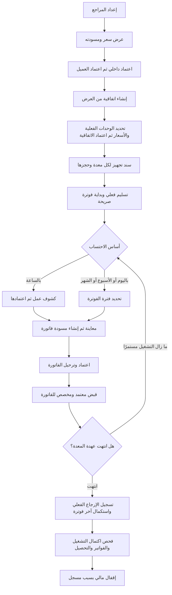

# تصور دورة تأجير المعدات من العرض إلى الإقفال

| البند | القيمة |
|---|---|
| Status | Draft |
| Owner verification pending | yes |
| التاريخ | 2026-10-30 |
| الغرض | شرح الدورة الحالية من المصدر وتجهيز تصور مراجعة العميل، دون تعديل التطبيق أو تجميد منطق مالي ناقص |

## مسار إنشاء الاتفاقية

نعم، الإجراء موجود في قائمة عروض المعدات: إنشاء اتفاقية رئيسية من عرض معتمد داخليًا ومن العميل، وليس له اتفاقية حية مرتبطة. إذا وُجدت اتفاقية يظهر مسار عرض الاتفاقية. يرسل الإجراء quotationId إلى محرر الاتفاقية، والخادم يتحقق من الاعتماد وعدم الارتباط السابق ويستمد العميل من العرض نفسه. العلاقة الحالية عرض واحد إلى اتفاقية حية واحدة، واتفاقية واحدة إلى عدة صفوف معدات وسندات تسليم وفواتير.

التصور الأساسي لمراجعة العميل هو اعتماد هذا المسار كرحلة العمل المعتادة. إنشاء اتفاقية مستقلة دون عرض موجود في النظام، لكن إلغاء هذا المسار أو جعله استثناء بصلاحية يحتاج قرارًا؛ هذه الوثيقة لا تضيف تقييد وصول.

المخطط يصف العلاقات وليس ترتيبًا زمنيًا جامدًا: يمكن تسجيل الإرجاع قبل إصدار الفاتورة الأخيرة أو تحصيلها، ويمكن الفوترة والتحصيل دوريًا أثناء التشغيل. لا تنتهي الدورة إلا بإتمام المسارين التشغيلي والمالي معًا.

## مراحل العمل ومخرجاتها

| المرحلة | ما يدخله المستخدم | الناتج وشرط الانتقال |
|---|---|---|
| تجهيز المراجع | العميل والفرع والمعدات والموديلات، وإعداد الحسابات والضريبة والعملة اللازمة للفوترة | مراجع صالحة؛ اختيار من القائمة لا يغني عن تحقق الخادم عند الكتابة |
| عرض السعر | العميل والفرع والتاريخ وأساس التأجير والمدة، وبنود الموديل والوحدات وأسعار مع/دون مشغل، والساعات المسموحة والرسوم المدعومة | مسودة عرض لا تحجز معدات ولا تسلمها ولا تبدأ الفوترة |
| اعتماد العرض | اعتماد داخلي ثم اعتماد العميل، أو رفض/مراجعة بحسب حالته | عرض مقبول يصلح مصدرًا للاتفاقية؛ لا يفترض توقيع إلكتروني أو موافقة خادم خارج النظام |
| إنشاء الاتفاقية | إجراء الإنشاء من العرض؛ العميل والمصدر ثابتان، وتواريخ الاتفاقية ومرجع أمر العميل والملاحظات | مسودة اتفاقية؛ عدد3 وحدات يجهز3 صفوف منفصلة، لا تسليمًا تلقائيًا |
| تجهيز صفوف الاتفاقية | معدة فعلية مختلفة لكل صف، وسعر صريح ووحدة يوم/أسبوع/شهر/ساعة، وموعد تسليم متوقع وعداد تجهيز اختياريان | مراجعة واختيار السعر قبل الاعتماد؛ سعر مع/دون مشغل لا يختار تلقائيًا من العرض. ربط بند العرض بالنوع الفعلي ما زال قرارًا منفصلًا |
| اعتماد الاتفاقية | مراجعة المعدات والأسعار والعملة والضريبة ثم اعتماد | تثبيت الشروط الحالية وجعل الاتفاقية المعتمدة للقراءة؛ موعدها المتوقع وحده لا ينشئ حجزًا |
| سند التجهيز | إنشاء سند من اتفاقية معتمدة مفتوحة، واختيار معدة من صفوفها والفرع والموقع وتاريخ التجهيز | سند واحد لمعدة واحدة؛ التجهيز المؤرخ يحجز المعدة ولا يبدأ الرسوم. لا يسمح بمسح تاريخ تجهيز غير مسلّم لتحرير الحجز |
| التسليم الفعلي | تسجيل تاريخ التسليم وبداية الفوترة كلًا على حدة | عهدة فعلية وبداية احتساب صريحة، مع فحص التوافر وعدم ازدواج المعدة؛ نص الحالة لا يحل محل التواريخ |
| تسجيل التشغيل | كشف مفرد أو إدخال يومي حتى200 صف، وفترة ووردية وساعات ومرفق اختياري | كشوف معلقة؛ يعتمد الصافي صراحة قبل الفوترة بالساعة. القيم عشرية حتى6 منازل، و1.5 تعني ساعة ونصف |
| المعاينة والفاتورة | من إجراءات التسليم، فترة شاملة البداية والنهاية ثم معاينة الكمية والسعر والضريبة والإجمالي | مسودة فاتورة لسند معدة واحد؛ الخادم يعيد تحقق المصادر عند الإنشاء، ويمنع ازدواج الفترة/الكشوف |
| الاعتماد والترحيل | من سجل فواتير التسليم، الحالة المالية ومراجعة الحسابات والفترة | فاتورة مرحلة وذمة قابلة للتحصيل؛ إنشاء المسودة وحده ليس ترحيلًا أو تسوية |
| القبض والتخصيص | إنشاء سند قبض من الفاتورة المرحلة وإدخال الدفع والتخصيص ثم اعتماد القبض | تخفيض المتبقي بمقدار التخصيص الفعال فقط؛ حفظ مسودة قبض لا يسدد الفاتورة، ويمكن أن يبقى جزء غير محصل |
| الإرجاع | تسجيل الإرجاع الفعلي للمعدة في سندها | انتهاء العهدة وحد الاحتساب مع شمول يوم الإرجاع؛ لا يسوي الرصيد أو يقفل الاتفاقية ماليًا تلقائيًا |
| الفوترة النهائية | استكمال الفترة حتى الإرجاع أو الكشوف المعتمدة المستحقة، ثم الترحيل والتحصيل | لا فترة مستحقة غير مغطاة، ولا كشوف معلقة، ولا مسودات أو أرصدة مفتوحة تمنع الإقفال |
| الإقفال المالي | فتح الحالة المالية للاتفاقية ومعالجة أسباب المنع ثم الإقفال بسبب | اتفاقية مقفلة مع سجل؛ الإقفال لا ينشئ إرجاعًا أو تحصيلًا افتراضيًا |

## قواعد الفوترة الحالية

الفوترة اليومية بالأيام الفعلية، والأسبوعية بالأيام/7، والشهرية بجزء الأشهر المحسوب من ذكرى بداية الفوترة وبأيام كل دورة الفعلية. هذه طريقة سيجما الحالية وليست اعتمادًا لكل طرق الأشهر الموجودة في المرجع. بالساعة تُستهلك الكشوف المعتمدة غير المفوترة كاملة داخل الفترة؛ لا يقتطع جزء مجهول من كشف يعبر حدودها. يؤخذ HoursToInvoice مرة واحدة، ولا تخصم الاستراحة أو تضاف ساعات المشغل الإضافية مرة ثانية. قراءة العداد لا تتحول تلقائيًا إلى صافي ساعات فوترة.

لا تستدل فاتورة تلقائية أو مهمة دورية من إمكانية الفوترة الدورية؛ المستخدم يراجع الفترة ويعاين وينشئ المسودة. كما أن تسجيل الساعات المسموحة أو رسوم النقل في العرض لا يثبت تطبيقها تلقائيًا في محرك الفوترة الحالي.

## تمييز المستندات والربط

أمر شراء المورد مسار اختياري لشراء معدات/احتياجات من مورد، وليس شرطًا لإنشاء الاتفاقية أو التسليم. مرجع أمر شراء العميل خارجي تجاري، وربط أوامر العميل الحالية مستقل عن أمر المورد ولا يخلق حيازة أو فاتورة. لا يلزم إدخال أمر تأجير وسيط جديد في الرحلة الحالية: الاتفاقية المعتمدة تنشئ التسليم مباشرة؛ المسار القديم يبقى تاريخًا للقراءة وفق عقده.

مثال: عرض لثلاث وحدات ← اتفاقية واحدة بثلاث معدات فعلية ← ثلاثة سندات تسليم، قد تختلف تواريخها وفروعها ← فواتير دورية لكل سند ← تحصيلات مخصصة ← إرجاع كل معدة واستكمال فواتيرها ← إقفال الاتفاقية بعد معالجة جميع أسباب المنع. لا نفترض أن فاتورة واحدة تجمع السندات الثلاثة؛ هذا ليس العقد الحالي.

## التصحيح والاستثناءات الموجودة

قبل ربط مستندات تابعة، تعدل المسودات وفق الحالة؛ الاعتماد والارتباط يحميان الشروط الأصلية. يمكن حذف تجهيز غير مسلّم بلا تبعيات بعد التأكيد. الكشف المعتمد/المفوتر لا يعدل مباشرة؛ إلغاء اعتماد كشف غير مفوتر يحتاج سببًا. المسودة المالية غير المقيدة يمكن حذفها لإتاحة المصدر ثم إعادة المعاينة والإنشاء. إلغاء فاتورة مرحلة يتطلب الشروط الحالية ومنها عدم وجود تخصيصات وفترة أصلية مفتوحة؛ لا يحذف التاريخ ولا نفترض أنه قيد عكسي آلي. إعادة فتح الاتفاقية لها سبب وسجل، وإلغاء فاتورة مرتبطة قد يعيد فتحها وفق المالك الحالي. النتيجة غير المؤكدة لأي كتابة تُراجع قبل تكرارها.

## سجل مراجعة العميل

المطلوب حسمه لاحقًا: دلالة نوع المعدة وربط بنود العرض بالوحدات الفعلية والسماح بزيادة/نقص الكمية؛ شمول المشغل أو فصله والملحقات؛ الحد الأدنى والساعات المسموحة والوقت الإضافي والتوقف؛ اختيار طريقة الشهر؛ رسوم النقل والرجوع؛ اعتماد/رفض التسليم متعدد المراحل والفحص؛ الاستبدال وإعادة التسليم؛ الودائع والحجز البنكي؛ والتأجير المنتهي بالتمليك. هذه تفاصيل مرجعية جزئية/ناقصة وليست وظائف مفعلة بمجرد إدراجها في التصور. كل قرار يجمّد قبل تعديل أثره على المصادر/الحسابات والتاريخ.

## المصادر وحدود الإثبات

رُوجع فعل إنشاء الاتفاقية وشروطه في `EquipmentQuotation/components/list/list.component.ts`، وحراس إنشاء/اعتماد الاتفاقية في `EquipmentMasterAgreementService.cs`، ومعاينة الكمية في `EquipmentRentalInvoiceService.Billing.cs`، وأسباب منع الإقفال في `EquipmentMasterAgreementService.Finance.cs`، والدليل داخل التطبيق `UserGuide/content/equipment-rental-guide.ts` والعقود الحالية. مرجع الدورة المحلية هو قسم11 للقطعة2026-10-28، وتفصيل المصادر والبصمات والفجوات في `EQUIPMENT_RENTAL_FULL_STACK_REVIEW.md` وخطة التكافؤ؛ لا مصدر خارجي أو API شُغل.

هذا تصور إرشادي مبني على المصدر، وليس قبولًا تشغيليًا أو تعهدًا ماليًا أو خطة تنفيذ لميزات جديدة. لم يُعدل التطبيق أو الترحيلات، ولم تُشغل builds/tests/lint/DB/browser/commit. لم تستخدم عمال إضافية لأن شرح التسلسل الواحد يستفيد من السياق المتحقق نفسه ولا يبرر تقسيمًا مستقلًا جديدًا. قبل الاستخدام الفعلي تبقى متطلبات الترحيل والبناء وقبول دورة كاملة عند المالك؛ لا يُفترض نجاح الترحيل من إصلاح ملفه فقط.
